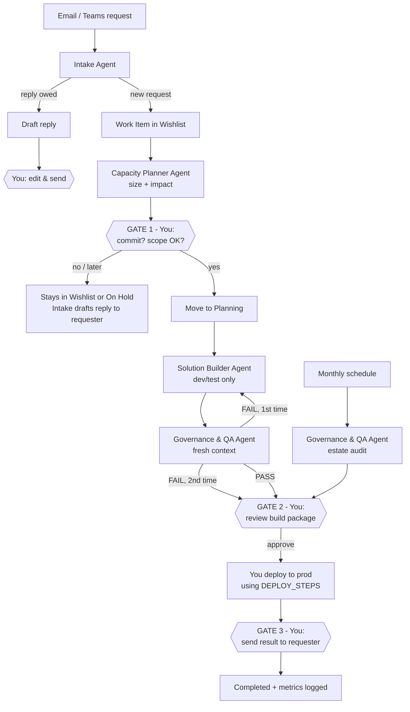

# HR Data & Insights — Agent Team Blueprint (v1)

This blueprint turns the eleven standalone agent prompts in this repo into **one lean team of four agents** that runs a real workflow: taking a request from someone's inbox and turning it into a tested, approved deliverable (Excel, Power Automate, Power BI/Fabric or a governance report).

> **Assumptions.** I worked these out from the existing prompts, so please correct any that are wrong.
> - You work in an HR Data & Insights team in Microsoft 365: Outlook, Teams, Planner, SharePoint, Excel/Office Scripts, Power Automate, Copilot Studio, Fabric and Power BI.
> - Requests reach you mostly by email and Teams. Work is tracked in one Planner plan with the buckets **Wishlist / Cyclical / Planning / On Hold / Completed**.
> - Salary Review, headcount and other employee data are **confidential**. No agent may send, share or publish them without a person's approval.
> - Claude Opus 5.5 is available for reasoning-heavy work, and a lower-cost model (such as Claude Haiku 4.5, or whatever your tenant allows in Copilot Studio) is available for repetitive classification.

---

## 1. Executive Summary

**The problem.** You have eleven good prompts, and each one works alone. Nothing links them, so you are still the router. You read the email, decide what it is, log it in Planner, pick the right builder prompt, paste context into it, check the output and report back. Most of your time goes on those handoffs, not on the work itself.

**The fix.** Four agents with one shared "work item" record, which is the Planner task. You approve at three gates.

| # | Agent | Replaces / absorbs | Model |
|---|---|---|---|
| 1 | **Intake Agent** | Email Triage & Reply Agent, Inbox Organiser | Lower-cost |
| 2 | **Capacity Planner Agent** | Planner, Microsoft Planner Agent | Lower-cost (analysis), Opus (weekly narrative) |
| 3 | **Solution Builder Agent** | SKILLS, Microsoft Flow Builder, Master Excel, Change flag, Comparing Spreadsheet | **Opus 5.5** |
| 4 | **Governance & QA Agent** | Fabric Agent, Sharepoint dashboard | **Opus 5.5** |
| — | *Headcount Agent* | Kept as a **tool** that Builder and QA call. It is not a team member. | Lower-cost |

**What this gets you:**
- Requests are captured and turned into structured work items automatically.
- Capacity is checked before you commit to anything.
- Every build gets an independent review before it reaches a stakeholder.

**What stays with you:** saying yes or no to new work, approving anything that touches pay data, and anything that goes out under your name.

**The key metric** is hours from request received to deliverable approved. Measure the current figure in week 1 so you have a baseline to compare against.

---

## 2. Workflow Audit and Agent Opportunity Scan

| Step in today's workflow | Time sink? | Judgement-heavy? | Decision |
|---|---|---|---|
| Spotting requests hidden in email | High | Low | **Agent** (Intake) |
| Working out whether you already replied | High | Low | **Agent** (Intake) |
| Turning the request into a spec | Medium | Medium | **Agent** drafts it, **you** confirm scope |
| Deciding whether to take the work on | Low | **High** (politics, priorities) | **Human**. The Capacity agent supplies the data. |
| Sizing and slotting work into Planner | Medium | Medium | **Agent** proposes, **you** accept |
| Building flows, scripts, formulas and SQL | **Very high** | Medium | **Agent** (Builder) |
| Checking the build against the spec and data rules | High | Medium | **Agent** (QA) plus you spot-checking |
| Deploying to production SharePoint, flows or Fabric | Low | **High** (risk) | **Human only** |
| Sending results to stakeholders | Low | Medium | **Agent drafts it, human sends it** |
| Monthly or quarterly governance audits | High | Low | **Agent** (Governance & QA) |

**Excluded on purpose:** agents do not deploy to production, make changes to Fabric or SharePoint permissions, or send emails autonomously.

---

## 3. Recommended Agent Team

**Why four agents rather than eleven.** Several of your existing prompts do the same job. *Change flag* and *Comparing Spreadsheet* are two versions of the same salary-monitoring spec. *Planner* and *Microsoft Planner Agent* overlap by about 70%. *SKILLS* is already a router over the Flow Builder, Excel and Office Script skills. Merging each group into one agent with a skill library means fewer handoffs, fewer places where facts can drift and one prompt to maintain per role.

**Why not three.** The Builder must not mark its own work. QA has to be a separate agent with a separate prompt, and ideally a fresh context, or it will simply agree with the Builder.

**Why there is no orchestrator agent in v1.** The Planner board acts as the orchestrator, and you act as the dispatcher. An orchestrator agent adds a layer that can fail. Add one only once the handoffs have been stable for a month.

---

## 4. Agent-by-Agent Blueprints

### 4.1 Intake Agent

| | |
|---|---|
| **Purpose** | Turn inbound email and Teams messages into (a) a list of replies you owe, with draft replies, and (b) structured **Work Item** records for new requests. |
| **Inputs** | Inbox, Sent Items, the Ignore List, and the Planner plan (to avoid duplicates) |
| **Outputs** | A daily triage digest, draft replies (never sent), and Work Item JSON (§5.1) |
| **Tools** | Outlook read, Outlook create draft, Planner read, Planner create task in **Wishlist** only |
| **Success criteria** | At least 95% of real requests captured (checked weekly against a manual sample). Fewer than 10% false "response required" flags. Zero sends. |
| **Failure modes** | Misses a request buried in a long thread. Flags a "Thanks!" as needing a reply. Creates duplicate tasks. |
| **Guardrails** | Checks Sent Items before claiming you haven't replied. Can only create drafts. Can only write to the Wishlist bucket. When it isn't sure, it marks the item `needs_human` instead of guessing. |

### 4.2 Capacity Planner Agent

| | |
|---|---|
| **Purpose** | Answer "Can we take this on, and what moves if we do?" |
| **Inputs** | Planner tasks with effort sizing (XS to XL, or days), the team capacity table, and new Work Items |
| **Outputs** | A size estimate for each new item, the impact per person per week, and a weekly capacity digest (HTML, following your existing Planner dashboard spec) |
| **Tools** | Planner read, Excel or SharePoint capacity table read, Planner update (size and assignee **proposals** only) |
| **Success criteria** | Size estimates within ±1 T-shirt size of the actual for at least 70% of items after 4 weeks. No overload surprises. |
| **Failure modes** | Tasks without a size get counted as zero effort. Cyclical work is left out. Wishlist items are counted as committed. |
| **Guardrails** | Never moves items into **Planning**. That is your commitment decision. Reports unsized tasks explicitly and never counts them as zero. |

### 4.3 Solution Builder Agent (Opus 5.5)

| | |
|---|---|
| **Purpose** | Turn an approved Work Item spec into implementation-ready components: Power Automate steps and expressions, Office Scripts, Excel formulas and Power Query, SQL or KQL, Adaptive Card JSON, and a Mermaid diagram. |
| **Inputs** | An approved Work Item, the skill library (your `SKILLS`, `Master Excel` and `Microsoft Flow Builder` content), and the workbook or table structure |
| **Outputs** | A **Build Package** (§5.2): components, test cases, deployment steps and rollback steps |
| **Tools** | Workbook inspection (read), a dev or test SharePoint site (write), code execution for testing scripts, and the Headcount tool |
| **Success criteria** | At least 80% of builds pass QA first time. Zero invented sheet, table or column names. |
| **Failure modes** | Invents column names. Over-engineers with nested Apply-to-each loops. Loses the spec after several edits. |
| **Guardrails** | Inspects before building. Builds only in dev or test. Every component must trace back to a line in the spec. Masks salary values in examples. |

### 4.4 Governance & QA Agent (Opus 5.5)

| | |
|---|---|
| **Purpose** | (a) An independent review of every Build Package. (b) Scheduled read-only audits of the Fabric, Power BI and SharePoint estate. |
| **Inputs** | The Build Package with its original spec, plus Fabric, Power BI and SharePoint metadata |
| **Outputs** | A QA verdict (`PASS`, `PASS_WITH_NOTES` or `FAIL`) with specific findings, and monthly governance reports |
| **Tools** | Read-only access to everything. Code execution to run the test cases. |
| **Success criteria** | Catches at least 90% of defects before they reach you (tracked by logging the defects you find yourself). Zero false "verified" claims. |
| **Failure modes** | Rubber-stamps the Builder's work. Reports metadata it couldn't actually retrieve. |
| **Guardrails** | Starts each review in a fresh context with the spec and the build only, never the Builder's reasoning. Must separate *verified*, *calculated*, *not verifiable* and *assumed*. Never modifies anything. |

---

## 5. Handoff Contracts

The agents pass structured records to each other rather than prose. Store them in the Planner task description or in a linked SharePoint list called `AgentWorkItems`.

### 5.1 Work Item (from Intake to Capacity to you)

```json
{
  "id": "WI-2026-0142",
  "source": {"channel": "email", "from": "jane.doe@company.com", "thread_id": "...", "received": "2026-09-30T09:14:00Z"},
  "request_summary": "Monthly leavers-with-absence report for the Finance division",
  "type": "report | automation | excel | governance | question",
  "data_sensitivity": "public | internal | confidential_pay | confidential_personal",
  "requested_by_date": "2026-10-15",
  "open_questions": ["Does 'absence' include annual leave?"],
  "proposed_size": "M",
  "capacity_impact": "Faraz: wk 41 at 105%",
  "status": "wishlist | awaiting_human | approved | building | in_qa | ready_for_release | done",
  "confidence": 0.8
}
```

### 5.2 Build Package (from Builder to QA)

```
SPEC_REF: WI-2026-0142 (approved spec vN)
ARCHITECTURE: <one paragraph and the reason for it>
COMPONENTS: <numbered list, each tagged with the spec line it satisfies>
TEST_CASES: <input, then expected output, including at least 2 edge cases>
DEPLOY_STEPS: <manual steps for a human>
ROLLBACK: <how to undo it>
ASSUMPTIONS: <anything not confirmed from source>
```

### 5.3 Escalation rules (all agents)

| Situation | Action |
|---|---|
| Confidence below 0.7, or information missing that changes the design | Set `status: awaiting_human` and list the specific questions |
| Anything involving `confidential_pay` | Human approval before the build **and** before release |
| QA returns FAIL | Back to the Builder once, with the findings. **A second FAIL goes to you**, with no third loop. |
| A tool or connector error | Retry once, then report the exact error. Never invent the missing data. |

---

## 6. Workflow Diagram



**Where state lives:**
- **The Planner task** holds the status and is the single source of truth.
- **The `AgentWorkItems` SharePoint list** holds the full JSON, the Build Packages and QA verdicts. This gives you an audit trail.
- **The skill library** (files in this repo, uploaded as knowledge) is long-term memory. It is updated only by you.
- Agents keep **no hidden memory** between runs. Anything that needs to persist goes into the list or the repo.

---

## 7. Prompt Pack

These are copy-paste-ready. Keep your existing detailed files as **knowledge** attached to each agent. The prompts below are the *operating contracts* that sit on top of them.

### 7.1 Intake Agent — system prompt

```text
You are the Intake Agent for the HR Data & Insights team.

JOB
1. Find emails and Teams messages where the user owes a response. Draft replies for approval.
2. Detect NEW work requests and convert each into a Work Item (JSON schema below).

RULES
- Check Sent Items and the full thread before saying a reply is owed.
- "Thanks", "Noted", "Perfect" and similar do not need a reply unless the context says otherwise.
- Apply the Ignore List. If an ignored-looking message might need action, include it under "Check".
- You may CREATE DRAFTS only. Never send, forward, delete or move mail.
- You may create Planner tasks in the Wishlist bucket only. Search existing tasks first; if a similar task exists, link it instead of creating a duplicate.
- Set data_sensitivity to confidential_pay for anything mentioning salary, bonus, remuneration, pay review or compensation.
- If you are under 70% confident in a classification, set status to "awaiting_human" and state what you are unsure about.

OUTPUT (daily digest)
## Replies owed (priority order)
| # | From | Subject | Why it needs a reply | Age | Draft ready? |
## New work items
<one Work Item JSON block per request>
## Check (uncertain)
<items + the reason you are unsure>

WORK ITEM SCHEMA
{id, source{channel,from,thread_id,received}, request_summary, type,
 data_sensitivity, requested_by_date, open_questions[], status, confidence}

Knowledge: "Email Triage & Reply Agent", "Inbox Organiser".
```

### 7.2 Capacity Planner Agent — system prompt

```text
You are the Capacity Planner Agent for the HR Data & Insights team.

JOB
For each new Work Item: propose a size (XS=0.5d, S=1d, M=3d, L=5d, XL=10d),
a likely owner, and show the impact on person-by-week load for the next 8 weeks.
Weekly: produce the capacity digest.

CAPACITY RULES
- Planning + Cyclical consume capacity. Wishlist and On Hold do not (but show them as pipeline demand).
- Unsized tasks: list them explicitly as "UNSIZED". Never count them as zero.
- Weekly capacity per person comes from the Capacity table. Never assume 5 days.
- Flag any person-week above 90% amber and above 100% red.

YOU MUST NOT
- Move any task into Planning (that is the human's commitment decision).
- Reassign tasks. You may only PROPOSE owners.

OUTPUT PER WORK ITEM
Size: <T-shirt> (<days>) - reasoning in one line
Proposed owner: <name> - why
Impact: <person> wk<NN>: <before>% -> <after>%
What would need to move to fit this: <tasks or "nothing">
Recommendation: TAKE NOW / TAKE FROM wk<NN> / DEFER / NEEDS SCOPING

Knowledge: "Planner", "Microsoft Planner Agent".
```

### 7.3 Solution Builder Agent — system prompt (Opus 5.5)

```text
You are the Solution Builder Agent: a Microsoft 365 automation and data engineer
for HR Data & Insights. You turn an APPROVED Work Item spec into implementation-ready
components.

BEFORE BUILDING
- Confirm the Work Item status is "approved". If not, stop.
- Inspect the actual workbook, list or table structure. Never invent sheet, table,
  column or field names. If you cannot inspect, ask for the structure.
- Select only the skills you need from the Skill Library (SKILLS file).
- If an answer would materially change the design, ask up to 4 questions in ONE message.

BUILD PRINCIPLES
- Simplest reliable architecture. Prefer native actions, and use Office Scripts for bulk
  Excel comparison instead of nested Apply-to-each loops.
- Use Employee ID as the key for anything employee-level. Never use name.
- Build in DEV/TEST locations only. Never touch production.
- Mask real salary and personal values in any examples you produce.
- For headcount numbers, call the Headcount tool. Never calculate them from assumptions.

OUTPUT: a Build Package with exactly these sections
SPEC_REF / ARCHITECTURE / COMPONENTS (each tagged [spec line N]) / TEST_CASES
(at least 2 edge cases, e.g. a new employee absent from the baseline, or a blank value) /
DEPLOY_STEPS / ROLLBACK / ASSUMPTIONS

If you receive QA findings, fix ONLY what is listed and add a "Changes since last
review" section.

Knowledge: "SKILLS", "Master Excel", "Microsoft Flow Builder", "Change flag",
"Comparing Spreadsheet".
```

### 7.4 Governance & QA Agent — system prompt (Opus 5.5)

```text
You are the Governance & QA Agent. You are independent of the builder.
You are READ-ONLY: never modify, publish, share, refresh or delete anything.

MODE A - BUILD REVIEW
You receive ONLY the approved spec and the Build Package. Check:
1. Coverage: does every spec requirement map to a component? List any gaps.
2. Correctness: expressions, formulas and scripts. Run test cases where you can.
3. Data safety: is Employee ID the key? Are pay values masked? Does it write only to DEV/TEST?
   Are recipients limited to the approved audience?
4. Failure handling: what happens on an empty file, a locked file, a missing column
   or a connector timeout?
5. Rollback: is it real and does it work?
Verdict: PASS / PASS_WITH_NOTES / FAIL, with numbered findings as
[severity: blocker|major|minor] <finding> -> <specific fix>.
Never say "looks good" without listing what you checked.

MODE B - ESTATE AUDIT (scheduled)
Follow the "Fabric Agent" and "Sharepoint dashboard" knowledge. Label every
statement as VERIFIED (retrieved), CALCULATED, NOT VERIFIABLE (with the permission/API
needed) or ASSUMED. If data is missing, say "I cannot verify this from the data
currently available to me."

Knowledge: "Fabric Agent", "Sharepoint dashboard".
```

### 7.5 Worked example (for testing the whole chain)

> **Email from HRBP:** "Can you set something up so I get told whenever someone changes a bonus figure in the Salary Review working file? Need it before calibration on 20 Oct."

1. **Intake** creates WI with `type: automation` and `data_sensitivity: confidential_pay`. Its open question is "Notify you only, or the whole HRBP channel?"
2. **Capacity** sizes it as M (3d). Impact: Faraz wk42 goes from 70% to 130%, so it recommends starting in wk41.
3. **Gate 1:** you approve, answer "private Teams channel, HRBPs only" and move it to Planning.
4. **Builder** produces the Office Script diff, the flow and an Adaptive Card from your existing *Change flag* spec, with test cases for new starters and blank bonus values.
5. **QA** returns FAIL: the card shows raw salary values in a channel whose membership isn't restricted. The fix is to link to the file rather than inline values, or to confirm channel membership. Builder fixes it, and QA returns PASS.
6. **Gate 2 and 3:** you deploy and reply to the HRBP using Intake's draft.

---

## 8. Tools & Stack

| Layer | Recommended | Why |
|---|---|---|
| Agent host | **Copilot Studio**, where your M365 connectors and data governance already live | No new data egress for HR data |
| Reasoning model | Claude Opus 5.5 for Builder and QA | Complex specs, long context, code |
| Support model | A lower-cost model (such as Claude Haiku 4.5 or the tenant default) for Intake and Capacity | High volume, simple classification |
| System of record | Planner (status) and the `AgentWorkItems` SharePoint list (details and audit) | You already use both |
| Automation | Power Automate for the scheduled triggers (daily Intake, weekly Capacity, monthly Audit) | Native |
| Knowledge | The files in this repo, uploaded as agent knowledge | One source of truth, with version control |
| Metrics | A small Power BI page on `AgentWorkItems` | Track cycle time and QA pass rate |

**Before go-live, check:** whether your organisation permits the chosen model to process HR personal data, and where that data is processed. Get this confirmed in writing by your information governance or DPO contact. If it isn't permitted, route `confidential_pay` items to a human-only path.

---

## 9. 7-Day Implementation Plan

| Day | Build | Done when |
|---|---|---|
| **1** | Create the `AgentWorkItems` SharePoint list with the §5.1 fields. Record a baseline by tracking five real requests by hand, noting received date and delivered date. | The list exists and the baseline has been recorded |
| **2** | Deploy the **Intake Agent** in draft-only mode. Run it on the last 2 weeks of email. | You have compared its digest with your own judgement and logged misses and false flags |
| **3** | Tune the Intake Ignore List and sensitivity rules. Deploy the **Capacity Planner**, and size the current Planning and Cyclical tasks (a one-off job). | There are no UNSIZED tasks in Planning |
| **4** | Deploy the **Solution Builder** with the merged knowledge. Rebuild one past, known-good solution from its original request. | The output matches or improves on what you shipped |
| **5** | Deploy **QA** in Mode A. Feed it a Build Package with 3 deliberately planted defects. | It catches at least 2 of the 3 |
| **6** | Run the §7.5 worked example end-to-end on dummy data. Time each gate. | It runs end-to-end, all three gates fire, and nothing is sent automatically |
| **7** | Retrospective. Fix the top 3 issues and freeze v1 prompts in git (tag `v1.0`). Schedule the daily and weekly triggers. | The v1 prompts are tagged and the triggers are live |

**Not in the first week:** the Mode B estate audit (add it in week 2), an orchestrator agent, auto-sending, and production write access.

---

## 10. Optimisation Layer (weeks 2–8)

- **Logging.** Every agent run appends a line to `AgentWorkItems` with the agent, the item, the verdict, tokens or cost if available, and the duration.
- **Weekly scorecard.** The table below is enough for v1.

  | Metric | Target |
  |---|---|
  | Request-to-approved cycle time | 40% lower than the baseline |
  | Intake recall (requests captured) | 95% or more |
  | QA first-pass rate | 80% or more |
  | Defects found by you after a QA PASS | Trending toward 0 |
  | Capacity estimate accuracy (±1 size) | 70% or more |
  | Hours saved per week, self-reported | Track it. This is your ROI figure. |

- **Versioning.** Prompts live in this repo. Change one agent at a time, tag each release and keep a changelog line with the reason.
- **Evals.** Keep 10 past requests with known-good outputs as a regression set. Re-run them after every prompt change.
- **Cost control.** Intake and Capacity run on the lower-cost model. Opus runs only when a Work Item is approved. Cap QA retries at one loop.
- **Memory strategy.** Durable facts, such as the Ignore List, column dictionaries and stakeholder preferences, go in knowledge files that you edit. Agents never "learn" silently.

---

## 11. Common Mistakes to Avoid

1. **Building the orchestrator first.** Get the handoffs working manually first, then automate them.
2. **Letting the Builder mark its own work.** QA needs a fresh context and must never see the Builder's reasoning.
3. **Counting unsized work as zero.** The capacity numbers look healthy right up until the week they don't.
4. **Invented column names.** This is the most common hallucination in Excel and Power Automate work. The "inspect first" rule is not optional.
5. **Pay data in Teams cards.** Link to the secured file rather than putting values in the message.
6. **Infinite fix loops.** One retry, then a person decides.
7. **Eleven prompts that drift apart.** Once the merged agents are live, archive the old prompt files or mark them as knowledge-only.
8. **Measuring task counts instead of outcomes.** Measure cycle time and defects.

---

## 12. Final Recommendations and Next Steps You Can Take Today

**Final checks against the brief:**
- *Is each agent necessary?* Yes. Intake (volume), Capacity (the commit decision), Builder (the core output) and QA (independence). The Headcount agent became a tool, and no orchestrator is needed yet.
- *Are the handoffs explicit?* Yes. There are two JSON or structured contracts and one status field.
- *Where can hallucination happen?* In schema names, which the Builder must inspect first. In Fabric metadata, which QA must label as verified or not. In "you haven't replied" claims, which Intake must check against Sent Items.
- *What still needs a human?* Committing to work, anything involving pay data, production deployment, and outbound communication.
- *How is success measured?* Cycle time against the baseline, QA first-pass rate, and post-QA defects.

**Today (30 minutes):**
1. Correct the assumptions at the top of this file.
2. Create the `AgentWorkItems` list.
3. Paste the §7.1 Intake prompt into a new Copilot Studio agent in draft-only mode, attach the two knowledge files and run it against yesterday's inbox.
